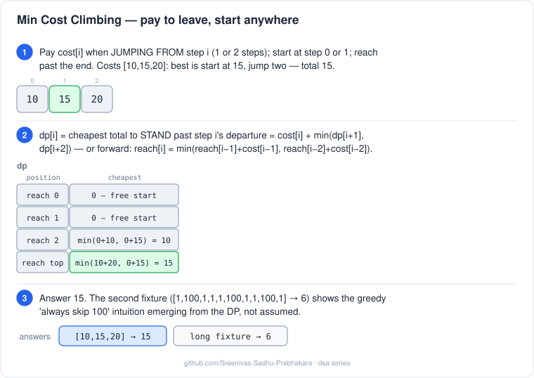

# Min Cost Climbing Stairs

> NeetCode 150 · 1-D DP — climbing stairs with weights: cheapest way to stand on step i is its cost plus the cheaper of the two predecessors; free start, free finish. Go, stdlib only, tested.

## Problem

Each step has a toll, paid when stood on; hops are 1 or 2 steps; you may start on step 0 *or* 1 and must end *past* the last step. Minimize total tolls.

## Approach

Let dp[i] = cheapest total that ends standing on step i: `cost[i] + min(dp[i−1], dp[i−2])`, seeded dp[0]=cost[0], dp[1]=cost[1] — the free choice of starting step is encoded entirely in those seeds, not in branches. The free finish means the answer is `min(dp[n−1], dp[n−2])` — the top is reachable by a final hop from either. Two rolling variables again. The specification quirks (where may I start? where exactly do I stop paying?) are the entire difficulty; the recurrence is climbing-stairs with a min instead of a sum.

**Complexity:** O(n) time, O(1) space.

## Visual walkthrough

Read the picture top to bottom — each numbered frame is one moment of the algorithm
running on this repo's test example.

## Run

    go test ./...   # verify
    go run .        # demo

---

Part of a 275-repo DSA series in Go — Striver's SDE Sheet (dsa-001–191) plus the NeetCode 150 / Blind 75 additions (dsa-192–275), stdlib only, every solution tested. Browse: [`dsa-*` repos](https://github.com/Sreenivas-Sadhu-Prabhakara?tab=repositories&q=dsa-&type=source).
